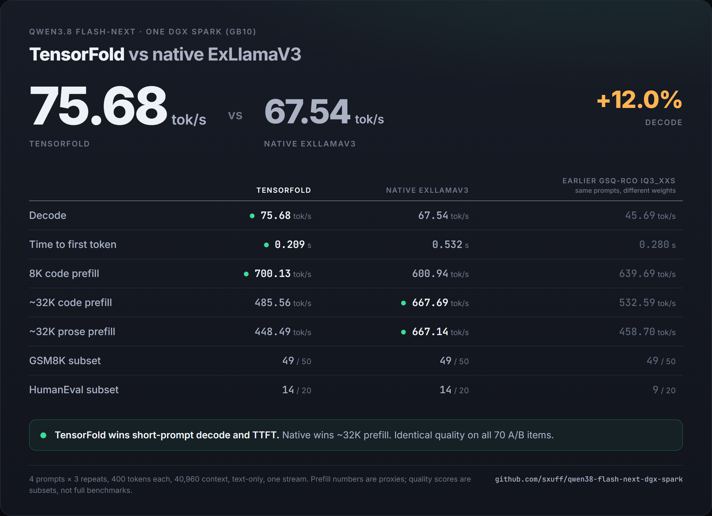

# Qwen3.8 Flash-Next on one DGX Spark or ASUS Ascent GX10

A **TensorFold EXL3 4.05** serving recipe for one NVIDIA GB10 with 128 GB unified memory. The default is **prompt-only expert kernels on, thinking enabled, 262,144-token context, native vision, image-aware prefix caching and MTP6**.

**Faster prefill, unchanged weights and runtime.** A matched three-repeat comparison qualified prompt kernels with 33 requests per arm, identical output token IDs on all 33 pairs, and five decode changes within 3%. Prefill improved **128.4%–135.6%** across 8K/32K/64K code and prose. At 64K code, native prefill rose **668 → 1,568 tok/s** and TTFT fell **98.54 → 42.02 seconds**. This is a prefill and TTFT improvement, not a decode-speed claim. [Measured results](results/prefill-repeat.md).

## The recipe

```text
Language weights: turboderp/Qwen3.8-Flash-Next-exl3
Quantization:     4.05bpw_h6_ng6
Runtime:          TensorFold 0.6.5, pinned source + vision-prefix/prompt patches
Prompt kernels:   on by default; --legacy-prefill-kernels selects the fallback
Hardware:         one GB10, 128 GB unified memory
Context:          262,144 tokens
MTP:              depth 6, confidence 0.70
KV cache:         BF16
Streams:          2, required for native vision
N-gram table:     demand-paged, prefetch=False
Lookup:           off
CUDA graphs:      on
Vision:           verified BF16 tower
Image history:    up to 64 images across the full message history
Prefix reuse:     unchanged complete processed-image history
API:              OpenAI-compatible, localhost:8001
Model ID:         qwen38-flash-next-tf405
Output default:   32,768 tokens, request-overridable
Thinking default: on, request-overridable
```

The language checkpoint includes its MTP head. No separate language drafter or language-loader patch is needed. The vision tower is a separate verified download; language weights remain unchanged.

## 1. Prepare the host

Use a GB10 host with working Docker GPU access, Python 3 and Git. The container includes its own Python 3.12, CUDA 13 development tools and pinned runtime dependencies.

```bash
git clone https://github.com/sxuff/qwen38-flash-next-dgx-spark.git
cd qwen38-flash-next-dgx-spark
uname -m
nvidia-smi
docker info
free -h
df -h "$HOME"
```

`uname -m` must report `aarch64`. Only one model-scale deployment should occupy the box. The serving launcher checks the preload headroom plan before starting and **does not stop other services** to make room. It keeps at least **7 GiB MemAvailable**, **20 GiB free disk**, **zero container swap**, and at most **1 GiB net host-swap growth** from launch. Stable pre-existing host swap is allowed; system swap settings are not changed.

## 2. Download and verify the weights

```bash
export MODEL_ROOT="$HOME/models/Qwen3.8-Flash-Next-EXL3-4.05"
export VISION_ROOT="$HOME/models/Qwen3.8-Flash-Next-BF16-vision"

python3 scripts/download_model.py \
  --manifest manifests/exl3-405.json \
  --destination "$MODEL_ROOT"

python3 scripts/download_model.py \
  --manifest manifests/vision-bf16.json \
  --destination "$VISION_ROOT"

export VISION_WEIGHTS="$VISION_ROOT/vision_tower_bf16.safetensors"
```

Both manifests pin immutable Hub revisions and file sizes. Large payloads use SHA-256; Git-stored metadata files use their Git-blob SHA-1. Downloads resume through temporary files, verify before promotion, and retain a 20 GiB disk reserve. `--verify-only` checks an existing download without writing it. Both artifacts are public; no Hub token is required.

- Language revision: `55a732e0c4c3d4614bc42b68493bb930d9b02c0a`
- TensorFold revision: `609ca419abecebdc5a059498a613680bd3aa847f`
- BF16 tower revision: `b5a234522364b10cdc4869844597bf77eeb942a7`
- BF16 tower SHA-256: `cdd69998e52e34badced49ef8ec09824b8b9a52e488094f0cadeadc7ebfc641e`

## 3. Build TensorFold

```bash
bash scripts/build_tensorfold.sh
```

The build uses an immutable ARM64 CUDA base, PyTorch **2.13.0+cu130**, Triton **3.7.1**, and the pinned TensorFold source. It verifies and applies [`patches/vision-prefix-cache.patch`](patches/vision-prefix-cache.patch) and [`patches/prompt-expert-kernels.patch`](patches/prompt-expert-kernels.patch) before installing the runtime. The Docker build verifies installed source hashes and both legacy/prompt source closures. These patches are part of this recipe, not the unmodified upstream release. It installs no other inference engine. The command finishes with CPU-side patched-runtime and image-processor imports. CUDA extensions compile on the first model load, with `MAX_JOBS=1`; their cache is retained under `runtime-cache/`.

## 4. Start the server

Foreground:

```bash
bash scripts/run_server.sh "$MODEL_ROOT" "$VISION_WEIGHTS"
```

Or install the user service:

```bash
bash scripts/install_service.sh "$MODEL_ROOT" "$VISION_WEIGHTS"
systemctl --user enable --now qwen38-flash-next-tensorfold.service
journalctl --user -u qwen38-flash-next-tensorfold.service -f
```

The installer verifies both artifact manifests. It refuses to overwrite an existing unit and does not start a deployment implicitly. The Docker container is capped at **112 GiB**, with service swap disabled. The independent host supervisor checks the reserve and swap-growth guards throughout startup and serving. A healthy idle server has no idle timeout.

The endpoint is bound to **127.0.0.1:8001**. This recipe does not install an external proxy or publish an unauthenticated API to the network.

## Prompt-only expert kernels: default and fallback

The unflagged foreground and service-install commands above select prompt kernels. `--prefill-kernels` remains accepted for compatibility and explicitly selects the same mode. To select the legacy prompt expert path at a future idle maintenance boundary:

```bash
bash scripts/run_server.sh "$MODEL_ROOT" "$VISION_WEIGHTS" --legacy-prefill-kernels
# Or, for a new service installation only:
bash scripts/install_service.sh "$MODEL_ROOT" "$VISION_WEIGHTS" --legacy-prefill-kernels
```

The installer still refuses to overwrite an existing unit and does not start it implicitly. Generated units pin the selected mode explicitly. The launcher passes `QWEN_PREFILL_KERNEL=1` by default or `0` for the legacy fallback and does not inherit an accidental host switch. Default and compatibility launches require the image label `qwen.prompt-expert.patch.sha256=bf884015181a1241b4038b25fdafff0f7d4887ce5725f112d99ba2f460f309fa`; an older image fails closed and must be rebuilt. The runtime revision check applies in both modes. Direct `scripts/serve.py` use also defaults on, honors an explicit `QWEN_PREFILL_KERNEL=0/1`, and accepts both mutually exclusive flags, which override that environment variable.

This integrates **grearjake-star's original [TensorFold PR212](https://github.com/ashhart/TensorFold/pull/212)** at `f28b49f6e91b1789e25345875d61c5e663c19b1a`. The PR was closed and unmerged at inspection. Larger explicit prompt windows (>64 rows) use the prompt expert kernels; decode and MTP verification remain on the legacy path. The prompt scratch window is 2048 rows instead of 1024, with the extra plan allocated before graph capture. The native capacity-plan difference is **480,285,400 bytes**, approximately **458 MiB**, included in launcher admission by default. Minimum preload available memory is **96,700,886,352 bytes** with prompt kernels versus **96,220,600,952 bytes** with the legacy fallback. Context, downloaded weight pin/file inventory, tokenizer/template, routing, BF16 KV, MTP6/confidence, two streams, vision and prefix-cache features are unchanged. Continuous reserve, swap and disk guards are unchanged.

Source integration is credited to the original author; the local comparison measures the upstream prompt kernels rather than claiming their invention.

A pull does not change an already-running container or installed unit. Rebuild and choose an idle restart explicitly. The installer does not overwrite an existing service or restart it implicitly.

## 5. Verify thinking, text, native vision and prefix reuse

```bash
python3 scripts/smoke.py --base-url http://127.0.0.1:8001
python3 scripts/smoke_vision_cache.py --base-url http://127.0.0.1:8001
```

The smoke checks model identity, the advertised 262,144-token context, a completed response with nonempty `reasoning_content` and no thinking override, a real text response and a generated two-color image. The latter two checks explicitly disable thinking to isolate text and vision behavior. The image prompt does not name the colors. Passing this check establishes functional thinking, text and native image input, not full-window quality.

Run the cache smoke on an idle server. It requires a cold image request, a repeated-image hit with an identical answer, an appended-text hit, a changed-image miss followed by a hit, and a completed five-image history. Usage is read from `usage.prompt_tokens_details.cached_tokens`. Its short requests explicitly disable thinking to isolate cache behavior. The five-image check verifies that the old four-image admission cap is gone; it is not a 64-image capacity test.

### Image-history caching

The limit of **64 images counts the entire submitted message history**, not just the latest turn. Byte, pixel and visual-token safeguards still apply. Long coding sessions can replay earlier screenshots without hitting the old four-image cap.

The patch caches **language-model prefix state for unchanged complete processed-image history**. Text appended after the images can reuse it. The cache key includes image content, processed pixels, layout and rotary metadata, so identical placeholder tokens cannot reuse a different screenshot's state. Changed, resized, reordered or added images conservatively miss. Videos remain on the cold path. The image tower still encodes the images on each request.

Two concurrent requests can return correct answers even when only one hits: a busy retained source with no spare slot safely falls back to a cold prefill. Cache reuse is automatic server-side; no client cache switch is required. Clients must preserve the image content and prompt prefix to reuse them.

The deployed source patch passed **95 CPU tests, with 1 skipped**, plus live same-image, appended-text, changed-image, text-cache and concurrent-stream functional checks. Exact counts and answers are retained in [`results/vision-prefix-cache.json`](results/vision-prefix-cache.json). These checks do not change the benchmark figures below and do not establish full-window or exhaustive sparse-cache correctness.

Example request:

```bash
curl http://127.0.0.1:8001/v1/chat/completions \
  -H 'Content-Type: application/json' \
  -d '{"model":"qwen38-flash-next-tf405","messages":[{"role":"user","content":"Write a Python function that validates a UUID."}],"max_tokens":2048,"temperature":0,"stream":false}'
```

The output default is 32,768 tokens when a request omits its own cap. `max_tokens` or `max_completion_tokens` can override it; input plus generated tokens must fit the configured context. A client must also send images as native image content, not just a local file path.

**Thinking is enabled by default.** Chat responses return it in `reasoning_content`, separately from the answer in `content`; streamed responses use the corresponding delta fields. Reasoning and the answer share the output token budget. A client must support that field to display thinking traces. To disable thinking for an individual request, send `"chat_template_kwargs":{"enable_thinking":false}`. Requests that omit the switch retain thinking.

For an existing deployment, rebuild with `bash scripts/build_tensorfold.sh` and restart at an idle boundary so the container uses the patched runtime and launcher. The image tag stays the same; a pull alone does not update an already-running container.

## Matched three-repeat prefill results

**Before = legacy; after = prompt kernels.** Both use EXL3 4.05/NG6, 262,144-token context, BF16 KV, MTP6/confidence 0.70, two streams and native vision. Each arm completed **33/33** requests: 12 short-decode requests, 3 long-context decode requests and 18 one-token prefill requests. This comparison measures timing and output identity, not a new task-quality panel.

### Prefix-uncached, page state uncontrolled: medians of 3 repetitions

| Prompt | TTFT before | TTFT after | Native prefill before | Native prefill after | Rate gain |
|---|---:|---:|---:|---:|---:|
| 8K code | 11.669 s | 4.979 s | 726.69 tok/s | 1711.77 tok/s | +135.6% |
| 8K prose | 11.516 s | 4.921 s | 739.13 tok/s | 1733.94 tok/s | +134.6% |
| ~32K code | 46.260 s | 19.990 s | 697.64 tok/s | 1616.17 tok/s | +131.7% |
| ~32K prose | 45.273 s | 19.844 s | 717.24 tok/s | 1638.42 tok/s | +128.4% |
| 64K code | 98.544 s | 42.015 s | 668.15 tok/s | 1568.19 tok/s | +134.7% |
| 64K prose | 97.361 s | 41.664 s | 676.29 tok/s | 1581.57 tok/s | +133.9% |

TTFT is request start to the first emitted sample. Native prefill rates include first-token sampling and are not isolated GPU kernel throughput or prompt-tokens/TTFT proxies. Each column is its own per-cell median over 3 repetitions. Prefix reuse was cleared between requests, but page residency was uncontrolled: **no cold-performance claim**. The retained ~32K fixtures contain 32,020 code and 32,196 prose prompt tokens.

| Post-first-emission decode cell | Before median | After median | Change |
|---|---:|---:|---:|
| Short code | 86.03 tok/s | 85.59 tok/s | -0.52% |
| Short math | 79.69 tok/s | 79.54 tok/s | -0.19% |
| Short prose | 56.85 tok/s | 56.84 tok/s | -0.02% |
| Short structured | 80.71 tok/s | 80.81 tok/s | +0.11% |
| 64K prose context | 90.54 tok/s | 90.91 tok/s | +0.40% |

These are also medians of 3 repetitions, with 400 generated tokens per request. All five changes meet the within-3% gate, not statistical equivalence. Output token-ID sequences matched on **33/33** paired requests, including the 18 one-token probes. This is bounded same-runtime identity evidence, not universal losslessness, full-window correctness or a new complete-answer quality result.

Exact values, counts, row-file hashes, paired token IDs and the default qualification: [`results/prefill-repeat.json`](results/prefill-repeat.json). [Measurement report](results/prefill-repeat.md). Only the prompt-kernel default changes. The NG6 checkpoint, pinned runtime, and safety policy are retained.

## Historical one-pass matched prefill screen

This earlier opt-in screen and its image are preserved as historical evidence, not the current three-repetition results above.


**Before = fresh incumbent A; after = A plus prompt-only kernels B.** Both use the same deployed EXL3 4.05 language weights, **262,144-token context, BF16 KV, MTP6/confidence 0.70, two streams and native vision enabled**. Unlike the historical runtime comparison below, this is a matched source treatment. One measured sweep per condition; no repeats or parameter fishing.

### Cold-advised, prefix-uncached

| Prompt | TTFT before | TTFT after | Prefill before | Prefill after | Rate gain |
|---|---:|---:|---:|---:|---:|
| 32K code | 57.82 s | 31.09 s | 557.34 tok/s | 1036.33 tok/s | +85.9% |
| 32K prose | 78.65 s | 52.41 s | 411.37 tok/s | 616.53 tok/s | +49.9% |
| 64K code | 98.50 s | 41.93 s | 668.41 tok/s | 1571.53 tok/s | +135.1% |
| 64K prose | 97.27 s | 41.73 s | 676.97 tok/s | 1579.07 tok/s | +133.3% |

Rates come directly from the native engine and include first-token sampling. They are **not isolated GPU kernel throughput** or TTFT-derived rates. File-scoped clean-page advice was attempted, but eviction/residency was not verified. The 64K advised cells had few or zero major faults and must not be called cold results. Warm prefix-uncached counterparts also improved; all 8K/32K/64K code/prose cells are retained in the historical receipt/report.

Post-first-emission decode changes versus A: code **+0.13%**, math **+0.02%**, prose **−0.45%**, structured **−0.47%**, 64K prose context **−0.17%**. These five cells emitted 400 tokens and hit the shared cap. The 32K code context emitted one EOS token in all arms, so its decode rate is unavailable. Within 3% is provisionally neutral in this screen, not statistical equivalence.

All **26/26 A→B** output token-ID sequences match, and all five same-runtime drafted-versus-serial pairs match. **27/27** feature smokes passed across A/B/C; bounded token identity and short feature checks do not establish universal losslessness or complete-answer quality. The original deployment was restored and authenticated generation verified. Minimum observed reserve was **26.89 GiB** in preparation and **28.81 GiB** in the continuous maintenance block; maximum positive host-swap growth and experiment-cgroup swap were both **zero**.

Exact cells, output/token-sequence hashes, immutable source provenance, counters, preparation tests and safety: [`results/prefill-screen.json`](results/prefill-screen.json). Human-readable report: [`results/prefill-screen.md`](results/prefill-screen.md). The table image is generated from these measured values, not upstream headline claims.

## Historical runtime comparison



**In this historical comparison, TensorFold wins short-prompt decode and TTFT. Native ExLlamaV3 wins the approximately 32K prefill proxies.** All 70 selected A/B quality items have identical pass/fail outcomes.

| Metric | TensorFold EXL3 4.05 | Native ExLlamaV3 EXL3 4.05 |
|---|---:|---:|
| Short-prompt decode | 75.68 tok/s | 67.54 tok/s |
| TTFT | 0.209 s | 0.532 s |
| 8K code prefill proxy | 700.13 tok/s | 600.94 tok/s |
| ~32K code prefill proxy | 485.56 tok/s | 667.69 tok/s |
| ~32K prose prefill proxy | 448.49 tok/s | 667.14 tok/s |
| GSM8K subset | 49/50 | 49/50 |
| HumanEval subset | 14/20 | 14/20 |
| Peak whole-host unavailable memory | 77.37 GiB | 80.29 GiB |

The benchmark used **40,960-token context, text-only, one stream**. Both A/B arms used the same EXL3 language weights, but this is a **recipe-deployment comparison**, not an isolated runtime toggle: TensorFold used MTP6, confidence 0.70 and BF16 KV; the tested native ExLlamaV3 fork used dynamic MTP5, confidence 0.60 and 8-bit KV.

Speed is the equal-weight mean of four per-prompt medians, with three repetitions and 400 generated tokens per request. Decode is a post-first-emission proxy; TTFT includes prefill and the first sample. Prefill is a single-token request-wall proxy including EOS and overhead, **not isolated kernel throughput**. The approximately 32K fixtures contain 32,020 code and 32,196 prose tokens. Whole-host unavailable memory is `MemTotal - min(MemAvailable)` across loading and collection, not GPU allocated memory.

The quality scores cover 50 GSM8K and 20 HumanEval selected items, not full benchmark scores. TensorFold's same-load drafted-versus-serial check matched **400/400 token IDs on each of four prompts**, not A/B output equivalence. The supplied card's additional reference column is preserved with its provenance in the result receipt; it is not another install profile.

**The default 262K/native-vision deployment is separate from this historical 40K/text-only benchmark.** Image and text functional checks passed, but the displayed throughput is **not** a 262K or vision-enabled benchmark. No full-window stress result is claimed.

Exact values, runtime pins, retained evidence hashes and card checksum: [`results/tensorfold-exl3-405.json`](results/tensorfold-exl3-405.json).

## Cleanup

```bash
systemctl --user disable --now qwen38-flash-next-tensorfold.service
rm -f "$HOME/.config/systemd/user/qwen38-flash-next-tensorfold.service"
systemctl --user daemon-reload
```

This stops only the recipe's owned container. Model files, the Docker image and compilation caches are retained.

## Licenses

The recipe scripts are MIT licensed. TensorFold is Apache-2.0 licensed. The model weights are separately governed by the [Qwen Community License 1.0](https://huggingface.co/Qwen/Qwen3.8-Flash-Next/blob/f5d08274bafd880402bd16f5e3e6c514136ec06c/LICENSE). Review the model license before downloading or deploying them.
